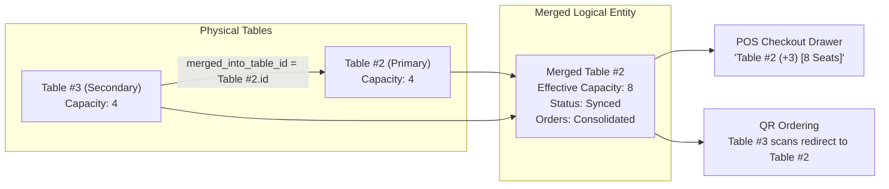

f# Table Merge Architecture & Implementation Specification

> **Target Module**: Table Management (`src/modules/tables/`, `src/app/[slug]/admin/tables/`)  
> **Target Branch**: `merge-table`  
> **Key Optimization Priority**: Minimal Memory Overhead & Zero Redundant Data Duplication (PostgreSQL Partial Indexes + In-Query Lateral Joins + Lean React State)

---

## 1. Executive Overview

In busy restaurant environments, physical tables frequently need to be joined together (e.g., Table 2 and Table 3 merged for a party of 8). 

This document defines the complete architectural design for the **Table Merge & Unmerge** feature in Devou Kitchen Queue. It is engineered specifically for **maximum memory efficiency**, preventing server-side memory bloat, avoiding recursive tree lookups, eliminating N+1 database queries, and keeping browser DOM/state light.



---

## 2. Memory-Optimized Architecture Principles

To satisfy the **"proper architecture without much memory wasting"** requirement, this design implements 5 critical optimizations:

| Layer | Traditional / Naive Approach (High Memory / Bloat) | Our Optimized Approach (Minimal Memory) |
| :--- | :--- | :--- |
| **Database Schema** | Creates a new `table_groups` table, duplicating rows and session objects. | **Single foreign key pointer (`merged_into_table_id UUID`)** directly on `restaurant_tables`. Exactly 16 bytes per row, zero new tables. |
| **Indexing** | Standard B-Tree index on all table rows (wasting RAM for unmerged tables). | **Postgres Partial Index**: `WHERE merged_into_table_id IS NOT NULL`. Index size is negligible (~0.5 KB per restaurant). |
| **Query Engine** | N+1 queries or heavy Node.js in-memory nested joins. | **Single SQL Query with `LATERAL` aggregation**: Postgres aggregates merged tables and orders directly into JSON in C-memory before sending to Node.js. |
| **Node.js Runtime** | In-memory tree structures, recursion, and object cloning. | **Flat 1-Level Depth constraint**: Max depth is strictly 1 (a child cannot be a parent; a primary cannot be merged into another primary). O(1) lookup. |
| **Frontend State** | Creating separate virtual table cards that inflate DOM elements and bundle state. | **Reuses existing table card array**: Secondary tables are visually docked or flagged without instantiating redundant state engines. |

---

## 3. Database Schema Design & Migration

### 3.1 Migration SQL: `migrations/migration_table_merge.sql`

```sql
-- Migration: Table Merge Support
-- 1. Add self-referencing foreign key for table merge
ALTER TABLE restaurant_tables
ADD COLUMN IF NOT EXISTS merged_into_table_id UUID REFERENCES restaurant_tables(id) ON DELETE SET NULL;

-- 2. Partial index: Only index tables that are actually merged into another table
-- This keeps memory consumption in Postgres shared buffers near zero
CREATE INDEX IF NOT EXISTS idx_restaurant_tables_merged_into 
ON restaurant_tables(restaurant_id, merged_into_table_id) 
WHERE merged_into_table_id IS NOT NULL;

-- 3. Safety constraint: Prevent a table from being merged into itself
ALTER TABLE restaurant_tables 
DROP CONSTRAINT IF EXISTS chk_no_self_merge;

ALTER TABLE restaurant_tables 
ADD CONSTRAINT chk_no_self_merge 
CHECK (id != merged_into_table_id);
```

### 3.2 Relational Logic

```
   ┌────────────────────────────────────────┐
   │          restaurant_tables             │
   ├────────────────────────────────────────┤
   │ id: UUID (PK)                          │
   │ restaurant_id: UUID (FK)               │
   │ table_number: VARCHAR(50)              │
   │ capacity: INT                          │
   │ status: 'AVAILABLE' | 'OCCUPIED'       │
   │ qr_code_url: TEXT                      │
   │ merged_into_table_id: UUID (FK, NULL) ───┐ (Points to parent table id)
   └────────────────────────────────────────┘ │
                       ▲                      │
                       └──────────────────────┘
```

- **Independent Table**: `merged_into_table_id IS NULL` and no children point to it.
- **Primary (Lead) Table**: `merged_into_table_id IS NULL` AND has 1 or more children pointing to its `id`.
- **Secondary (Merged) Table**: `merged_into_table_id = <primary_table_id>`.

---

## 4. Query Architecture (High Performance, Single-Query)

In `src/modules/tables/tables.repository.ts`, the `getTablesByRestaurant` method is enhanced to return merged details and calculate `effective_capacity` directly inside PostgreSQL:

```sql
SELECT 
  t.*,
  -- Calculate combined seating capacity in SQL without Node.js loops
  (t.capacity + COALESCE(children.extra_capacity, 0))::int AS effective_capacity,
  COALESCE(children.merged_numbers, '[]'::json) AS merged_table_numbers,
  COALESCE(children.merged_ids, '[]'::json) AS merged_table_ids,
  parent.table_number AS parent_table_number,
  COALESCE(active.active_orders_count, 0)::int AS active_orders_count,
  COALESCE(active.orders_json, '[]'::json) AS active_orders
FROM restaurant_tables t
-- Join parent info if this table is a secondary merged table
LEFT JOIN restaurant_tables parent ON parent.id = t.merged_into_table_id
-- Lateral aggregation of child tables merged into this table
LEFT JOIN LATERAL (
  SELECT 
    SUM(c.capacity)::int AS extra_capacity,
    json_agg(c.table_number ORDER BY c.table_number) AS merged_numbers,
    json_agg(c.id) AS merged_ids
  FROM restaurant_tables c
  WHERE c.merged_into_table_id = t.id
) children ON true
-- Active orders join (consolidating orders from primary and any merged children)
LEFT JOIN (
  ...
) active ON active.table_number = t.table_number
WHERE t.restaurant_id = $1
ORDER BY 
  CASE WHEN t.table_number ~ '^[0-9]+$' THEN t.table_number::integer ELSE 999999 END ASC, 
  t.table_number ASC;
```

**Benefits**:
1. Zero N+1 queries.
2. In-memory footprint in Node.js is minimal: `effective_capacity` and `merged_table_numbers` are already computed numbers and tiny string arrays.

---

## 5. Core Business Workflows

### Scenario 1: Empty + Empty Merge (Pre-Seating for Big Group)
- **Action**: Staff merges Table 4 (cap 4) and Table 5 (cap 4) before guests arrive.
- **Result**: Table 4 becomes Primary with effective capacity of 8. Table 5 is marked as `Merged into Table 4`. Status remains `AVAILABLE`.

### Scenario 2: Occupied + Empty Merge (Party Expansion)
- **Action**: Table 4 has 4 guests. 3 more arrive, so staff slides Table 5 next to Table 4 and merges them.
- **Result**: Table 5's status becomes `OCCUPIED`. Table 4's effective capacity expands to 8. Table 4 retains its active ticket.

### Scenario 3: Occupied + Occupied Merge (Bills/Parties Combining)
- **Action**: Table 4 and Table 5 were seated separately, but decide to combine into one party.
- **Result**: Table 5 is merged into Table 4. All active orders on Table 5 (`table_number = '5'`) are atomically updated to `table_number = '4'`. Table 4 now shows both order tickets in its active orders drawer.

### Scenario 4: Unmerging (Separation or Bill Settlement)
- **Action**: Party leaves and bill is paid, or staff manually taps **Unmerge**.
- **Result**: 
  1. `UPDATE restaurant_tables SET merged_into_table_id = NULL WHERE id = $secondary_id;`
  2. Both tables revert to their original standalone capacities.
  3. Status re-evaluation runs for both tables independently.

---

## 6. Complete List of Files to Create & Modify

### 6.1 Files to CREATE

| # | File Path | Purpose |
| :- | :--- | :--- |
| 1 | `migrations/migration_table_merge.sql` | Database migration script: column addition, partial index, check constraint. |
| 2 | `src/app/api/tables/merge/route.ts` | Next.js POST API endpoint for merging tables with validation and atomic transaction. |
| 3 | `src/app/api/tables/unmerge/route.ts` | Next.js POST API endpoint for unmerging a table or an entire merged group. |
| 4 | `src/components/modules/tables/MergeTableModal.tsx` | Modern, responsive modal UI: select Primary Table, select secondary tables to merge, live preview of combined capacity & active orders. |
| 5 | `TABLE_MERGE_ARCHITECTURE.md` | *(This document)* Root documentation for the architecture. |

---

### 6.2 Files to MODIFY

| # | File Path | Modifications Required |
| :- | :--- | :--- |
| 1 | `src/modules/tables/tables.repository.ts` | • Add `merged_into_table_id`, `effective_capacity`, `merged_table_numbers`, `parent_table_number` to `RestaurantTable` interface.<br/>• Update `getTablesByRestaurant` SQL to compute `effective_capacity` and `children`.<br/>• Add `mergeTables(restaurantId, primaryTableId, secondaryTableIds)` method using `pool.connect()` transaction.<br/>• Add `unmergeTable(restaurantId, tableId)` method.<br/>• Update `deleteTable` to prevent deleting a table that has active merged children. |
| 2 | `src/modules/tables/tables.service.ts` | • Add `mergeTables` service method with business validations:<br/>  - Cannot merge a table into itself.<br/>  - Cannot merge if target table is already a secondary table (depth = 1 restriction).<br/>  - Consolidation of active orders if secondary table has active orders.<br/>• Add `unmergeTable` service method with status re-evaluation. |
| 3 | `src/components/modules/tables/TableCard.tsx` | • Visual badge for Primary Table: `🔗 Merged (+3, +4)` with link styling.<br/>• Display `effective_capacity` in visual chair diagram and capacity pill.<br/>• Quick "Unmerge" action button on Primary Table card.<br/>• Muted/docked appearance for Secondary Table with click-to-jump to Primary Table. |
| 4 | `src/app/[slug]/admin/tables/page.tsx` | • Add "Merge Tables" button to header action toolbar.<br/>• Integrate `MergeTableModal`.<br/>• Add unmerge confirmation handler with optimistic UI updates. |
| 5 | `src/lib/table-capacity.ts` | • Update `checkTableAssignment` to check `table.effective_capacity || table.capacity` so party size validation accurately reflects merged space. |
| 6 | `src/components/modules/pos/POSCheckoutDrawer.tsx` | • Update Table selector dropdown: Show primary tables with badge (e.g. `Table 2 [Merged: +3] (8 Seats)`).<br/>• Disable or route secondary tables to their primary table. |
| 7 | `src/app/api/setup/route.ts` | • Add `merged_into_table_id` to initial table setup script for clean database installations. |

---

## 7. API Specifications

### 7.1 POST `/api/tables/merge`
Merges one or more secondary tables into a primary table.

**Request Body**:
```json
{
  "primary_table_id": "c1f7b8a0-2f9b-4e8c-a991-8d2b1f8c1234",
  "secondary_table_ids": [
    "e2a8c9b1-3e0c-5f9d-b002-9e3c2f9d5678"
  ]
}
```

**Response (200 OK)**:
```json
{
  "success": true,
  "message": "Tables merged successfully into Table #2",
  "primary_table_number": "2",
  "effective_capacity": 8,
  "merged_tables": ["3"]
}
```

**Atomic Transaction Logic**:
```typescript
await client.query('BEGIN');
// 1. Validate primary table exists and is not already a child of another table
// 2. Set merged_into_table_id for all secondary tables
await client.query(
  `UPDATE restaurant_tables 
   SET merged_into_table_id = $1, updated_at = CURRENT_TIMESTAMP
   WHERE restaurant_id = $2 AND id = ANY($3::uuid[])`,
  [primaryTableId, restaurantId, secondaryTableIds]
);
// 3. Re-route any active orders on secondary tables to primary table number
await client.query(
  `UPDATE orders 
   SET table_number = $1, table_id = $2, updated_at = CURRENT_TIMESTAMP
   WHERE restaurant_id = $3 
     AND table_number = ANY($4::varchar[]) 
     AND status NOT IN ('CLOSED', 'CANCELLED', 'EXPIRED')`,
  [primaryTable.table_number, primaryTable.id, restaurantId, secondaryTableNumbers]
);
// 4. Update status of primary and secondary tables
await client.query('COMMIT');
```

---

### 7.2 POST `/api/tables/unmerge`
Decouples merged tables back into independent units.

**Request Body**:
```json
{
  "table_id": "c1f7b8a0-2f9b-4e8c-a991-8d2b1f8c1234"
}
```
*(If `table_id` is a primary table, it unmerges all its children. If it is a secondary table, only that secondary table is detached).*

**Response (200 OK)**:
```json
{
  "success": true,
  "message": "Table(s) unmerged successfully"
}
```

---

## 8. UI / UX Design Specifications

### 8.1 Table Management Page (`/admin/tables`)
- **Top Actions Bar**: Next to `+ Add Table`, add a new secondary button:
  ```tsx
  <button onClick={() => setIsMergeModalOpen(true)}>
    <Link2 size={16} /> Merge Tables
  </button>
  ```
- **Primary Table Card**:
  - Badge at top: `[ 🔗 Merged: +3, +4 ]` in amber/primary tone.
  - Visual diagram updates chair count to `effective_capacity` (e.g. 8 chairs instead of 4).
  - Quick action icon button: `<Unlink size={14} />` with tooltip *"Unmerge Tables"*.
- **Secondary Table Card**:
  - Subtle striped or muted border.
  - Notice text: `Merged into Table #2`.
  - Disabled direct POS order button with a shortcut: *"Go to Primary Table #2"*.

### 8.2 Merge Modal (`MergeTableModal.tsx`)
1. **Step 1: Pick Lead / Primary Table**: Dropdown / Grid of available or occupied tables.
2. **Step 2: Select Tables to Join**: Multi-select checkboxes for other tables (shows individual capacities).
3. **Step 3: Live Summary Banner**:
   - Combined Capacity: `4 + 4 = 8 Seats`
   - Active Orders alert: If secondary table has orders: *"1 active order from Table 3 will be combined under Table 2"*.
4. **Action**: `[ Confirm & Merge Tables ]`

---

## 9. Edge Cases & Safety Matrix

| Edge Case | Risk | Prevention / Solution |
| :--- | :--- | :--- |
| **Circular Merging** | Infinite loops (Table A &rarr; B &rarr; A). | **Strict Depth = 1 rule**: A table can only be merged into a table whose `merged_into_table_id IS NULL`. Secondary tables cannot have children. Validated in DB check constraint and service. |
| **Deleting a Merged Table** | Orphaned children or broken parent links. | `ON DELETE SET NULL` on foreign key; `deleteTable` service checks if table has merged children and prompts to unmerge first. |
| **Customer Scans Secondary QR** | Customer places order on Table 3 when it's merged into Table 2. | In `/menu` route, if `table=3` has `merged_into_table_id`, resolve table to Primary (`Table 2`) so all kitchen KOTs and bills stay on the same active ticket. |
| **POS Bill Settlement** | Staff finishes paying order for Table 2; Table 3 remains locked in OCCUPIED. | When bill is paid, table status auto-syncs. POS checkout drawer offers a one-click checkbox: `[x] Automatically unmerge tables on payment`. |

---

## 10. Implementation Sequence (Ready for Execution)

1. **Phase 1: DB Migration & Types**
   - Execute `migration_table_merge.sql`.
   - Update `RestaurantTable` type in `tables.repository.ts`.
2. **Phase 2: Repository & Service Implementation**
   - Update `getTablesByRestaurant` SQL query.
   - Implement `mergeTables` and `unmergeTable` methods with SQL transactions.
3. **Phase 3: API Endpoints**
   - Create `src/app/api/tables/merge/route.ts` & `src/app/api/tables/unmerge/route.ts`.
4. **Phase 4: UI Components**
   - Create `MergeTableModal.tsx`.
   - Update `TableCard.tsx` with merged indicators and unmerge action.
   - Add trigger in `src/app/[slug]/admin/tables/page.tsx`.
5. **Phase 5: POS & Capacity Integration**
   - Update `src/lib/table-capacity.ts` to respect `effective_capacity`.
   - Update `POSCheckoutDrawer.tsx` to display merged status.
6. **Phase 6: Verification & Testing**
   - Test Empty+Empty, Occupied+Empty, Occupied+Occupied, and Unmerge flows.
