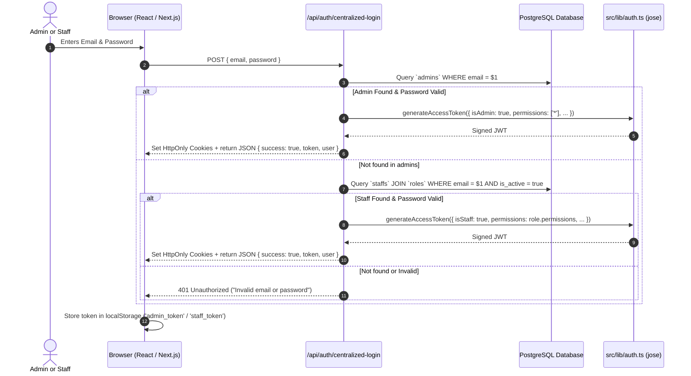
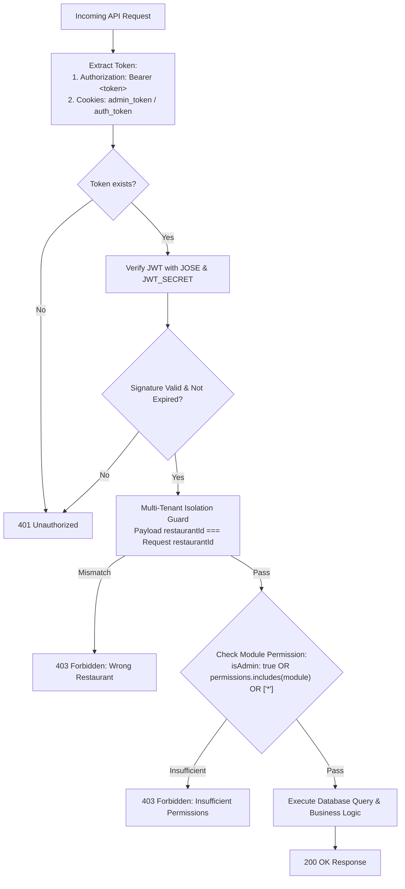

# Technical Deep-Dive: Authentication & Authorization Architecture

This document provides a comprehensive technical overview of the **Authentication (AuthN)** and **Authorization (AuthZ)** systems implemented across the Devou Kitchen Queue platform. It explains how tokens are generated, how and where client services inject `Bearer` tokens, and how API endpoints validate identities, permissions, and tenant boundaries.

---

## 1. System-Wide Identity & Role Hierarchy

The platform manages multiple tiers of actors with distinct privileges, token lifespans, and access scopes:

| Actor Tier | Identity Table | Primary Role / Scope | Granted Permissions | Authentication Method |
| :--- | :--- | :--- | :--- | :--- |
| **Super Admin** | `admins` (`is_super_admin: true`) | Platform Owner / Multi-Tenant Operator | Global unrestricted access across all tenants | Email + Password |
| **Restaurant Admin / Owner** | `admins` | Store Owner | Wildcard `['*']` (Full restaurant control) | Email + Password |
| **Staff Member** | `staffs` (linked to `roles`) | Operational Roles (Manager, Cashier, Waiter, Kitchen) | Module-specific array: `['pos', 'orders', ...]` | Email + Password (via Owner provisioning) |
| **Dining Customer** | `users` | Guest / Dine-In / Online customer | Profile, self-order history, active queue status | Phone Number + One-Time Password (OTP) |
| **Automated System** | N/A (Environment) | Cron Jobs, Webhooks, POS Printers | Endpoint-specific execution | Cryptographic `Bearer ${CRON_SECRET}` |

---

## 2. Token Architecture & Payloads

The system uses standard **JSON Web Tokens (JWT)** signed via HMAC-SHA256 (`HS256`) using the `jose` library in `src/lib/auth.ts`.

### 2.1 JWT Access Token Structure
Every authenticated admin, staff member, or customer receives an access token with this standard schema:

```typescript
export interface JWTPayload {
  userId: string;              // UUID in admins, staffs, or users table
  phone?: string;              // Customer phone number (if customer)
  email?: string;              // Account email address
  name?: string;               // Display name
  isAdmin: boolean;            // true for Store Owners & Super Admins
  isSuperAdmin?: boolean;      // true strictly for Platform Super Admins
  restaurantId?: string;       // Restaurant UUID (Multi-tenant partition)
  restaurantSlug?: string;     // URL slug (e.g. 'starbucks', 'bistro')
  restaurantName?: string;     // Display restaurant name
  isStaff?: boolean;           // true for operational staff members
  role?: string;               // Display role: 'Owner', 'Manager', 'Cashier', 'Waiter'
  roleId?: string;             // Foreign key UUID to `roles` table
  permissions?: string[];      // Granted module keys or ['*']
  iat?: number;                // Issued at timestamp
  exp?: number;                // Expiration timestamp (Default: 24h / 1d)
}
```

### 2.2 Token Storage Strategy (Hybrid Architecture)
To support both **Next.js Server-Side Middleware / SSR** and **Client-Side SPA / API Fetch Calls**, the system employs a hybrid storage strategy:

1. **HttpOnly Cookies**:
   - `admin_token`: HttpOnly access token for Admin & Staff sessions.
   - `admin_refresh_token`: Long-lived HttpOnly token (90 days) for session renewal.
   - `auth_token`: HttpOnly access token for Customer sessions.
   - `refresh_token`: Long-lived HttpOnly token (365 days) for customer renewal.
   - `super_admin_token`: HttpOnly token strictly for `/super-admin/*` routes.
   - *Advantage*: Immune to XSS-based theft; automatically attached on full-page navigation.

2. **Browser Storage (`localStorage`)**:
   - `admin_token`: Used by client API service singletons to construct `Authorization: Bearer <token>`.
   - `staff_token`: Kept for staff client components and tablet views.
   - `auth_token`: Used by customer ordering and queue interfaces.
   - `admin_user` / `user`: Non-sensitive user profile cache for instantaneous UI hydration.

---

## 3. How Authentication Happens (Login Lifecycles)

### 3.1 Store Admin & Staff Authentication Flow
Both restaurant owners and staff log in through either the Centralized Login (`/api/auth/centralized-login`) or the Tenant Admin Login (`/api/auth/admin-login`):



### 3.2 Customer Phone OTP Authentication Flow
Customer authentication is stateless and uses a dual-JWT mechanism:
1. **Send OTP (`/api/auth/send-otp`)**:
   - Validates the phone format (`+91XXXXXXXXXX`).
   - Generates a random 4-digit OTP.
   - Encrypts `{ phone, otp, purpose: 'otp_verification' }` into a short-lived JWT (1 minute expiry) signed with `JWT_SECRET`.
   - Sends the SMS via Fast2SMS DLT gateway.
   - Returns `{ success: true, otp_token }` to the client. No OTP is ever saved in plaintext in the database.
2. **Verify OTP (`/api/auth/verify-otp`)**:
   - Receives `{ code, otp_token }`.
   - Cryptographically verifies the `otp_token`. If expired (> 60s) or tampered, rejects immediately.
   - If `payload.otp === code`, creates or retrieves the user in the `users` table.
   - Issues 1-day `auth_token` and 365-day `refresh_token`.

---

## 4. Where APIs Take Bearer Tokens (Client-Side Architecture)

Every API request dispatched from frontend components or services incorporates the `Authorization: Bearer <token>` header through a standardized client architecture.

### 4.1 Centralized Service Layer (`getAuthHeaders`)

All API services in `src/app/services/` implement a `getAuthHeaders()` helper that reads the token from browser storage and packages it into the standard HTTP header:

```typescript
// Pattern used across: products.api.ts, orders.api.ts, admin.api.ts, tables.api.ts, inventory.api.ts
private getAuthHeaders(): Record<string, string> {
  if (typeof window === 'undefined') return {};
  let token: string | null = null;
  const path = window.location.pathname;

  // 1. Resolve appropriate token based on route context
  if (path.startsWith('/admin') || path.includes('/admin')) {
    token = localStorage.getItem('admin_token');
  } else if (path.includes('/staff')) {
    token = localStorage.getItem('staff_token') || localStorage.getItem('admin_token');
  } else {
    token = localStorage.getItem('auth_token');
  }

  // 2. Fallback cascade
  if (!token) {
    token = localStorage.getItem('admin_token') || 
            localStorage.getItem('staff_token') || 
            localStorage.getItem('auth_token');
  }

  // 3. Extract tenant slug
  const segments = path.split('/').filter(Boolean);
  let slug = segments[0];

  const headers: Record<string, string> = {};
  if (token) headers['Authorization'] = `Bearer ${token}`;
  if (slug) headers['x-restaurant-slug'] = slug;
  
  return headers;
}
```

### 4.2 Comprehensive Inventory of API Bearer Callers

| File Location | Purpose / Endpoint Called | Token Source Read |
| :--- | :--- | :--- |
| `src/app/services/orders.api.ts` | `/api/orders`, `/api/orders/[id]` | `admin_token`, `staff_token`, `auth_token` |
| `src/app/services/products.api.ts` | `/api/products`, `/api/categories` | `admin_token`, `staff_token`, `auth_token` |
| `src/app/services/admin.api.ts` | `/api/admin/staff`, `/api/admin/roles` | `admin_token` |
| `src/app/services/tables.api.ts` | `/api/tables`, `/api/tables/merge` | `admin_token`, `staff_token` |
| `src/app/services/inventory.api.ts` | `/api/inventory/*`, `/api/recipes/*` | `admin_token`, `staff_token` |
| `src/app/services/imagekit.service.ts` | `/api/upload/imagekit-auth` | `admin_token`, `staff_token` |
| `src/app/services/auth.api.ts` | `/api/users/me`, `/api/auth/refresh` | `auth_token`, `admin_token` |
| `src/components/CounterDrawer.tsx` | `/api/admin/counters` | `admin_token` |
| `src/components/CounterHardwareSettings.tsx` | `/api/admin/counters/hardware` | `admin_token` |
| `src/components/PrintStationListener.tsx` | KOT WebSocket / Printer Queue Auth | `admin_token` / `staff_token` |
| `src/components/modules/products/CategoryReorderModal.tsx` | `/api/categories/reorder` | `admin_token` / `staff_token` |
| `src/components/modules/products/ReuseCustomizationModal.tsx` | `/api/products` (clone customizations) | `admin_token` / `staff_token` |

---

## 5. How API Authorization Works (Server-Side Architecture)

Every Next.js API route (`/api/*`) verifies incoming requests through a multi-stage validation pipeline:



### 5.1 Dual-Source Token Extraction
Server endpoints do not rely solely on cookies or headers. Instead, they extract the token symmetrically from both:

```typescript
// Extracted from src/lib/auth.ts -> requireAdmin(request)
let adminToken: string | undefined;
let staffToken: string | undefined;

// 1. Try Next.js Request Cookies
if (request.cookies && typeof request.cookies.get === 'function') {
  adminToken = request.cookies.get('admin_token')?.value;
  staffToken = request.cookies.get('staff_token')?.value;
}

// 2. Try HTTP Authorization Header (Bearer Token)
let authHeader = request.headers.get('Authorization')?.replace('Bearer ', '');
if (authHeader === 'null' || authHeader === 'undefined' || authHeader === '') {
  authHeader = undefined;
}

// 3. Assemble verification pipeline
const tokensToTry = [authHeader, adminToken, staffToken].filter(Boolean) as string[];

for (const t of tokensToTry) {
  const payload = await verifyToken(t);
  if (payload && (payload.isAdmin || payload.isStaff)) {
    return payload; // Authentication Successful
  }
}

return null; // 401 Unauthorized
```

### 5.2 Server Guard Functions Reference

| Guard Function | File Location | Target Caller | Verification Rules |
| :--- | :--- | :--- | :--- |
| `requireSuperAdmin(request)` | `src/app/api/super-admin/*` | Super Admins | Requires valid token where `payload.isSuperAdmin === true`. |
| `requireAdmin(request)` | `src/lib/auth.ts` | Admins & Staff | Requires valid token where `payload.isAdmin === true || payload.isStaff === true`. |
| `getAuthContext(request)` | `src/lib/auth.ts` | Dual Endpoints | Returns `{ admin, customer }`, allowing both staff POS and online customer orders. |
| `verifyToken(token)` | `src/lib/auth.ts` | Any | Verifies cryptographic signature and expiration of any issued JWT. |

---

## 6. Role-Based Access Control (RBAC) & Module Permissions

Once an identity is authenticated, the system evaluates **module permissions**:

### 6.1 Available Permission Modules

```
┌────────────────────────────────────────────────────────────────────────┐
│                        Module Permission Keys                          │
├──────────────┬─────────────────────────────────────────────────────────┤
│ pos          │ Point of Sale order creation and billing               │
│ orders       │ Kitchen Display System (KDS), Live Queue, Order Board   │
│ tables       │ Table layout, QR seating, and dine-in management        │
│ products     │ Menu catalog, portion prices, and customization groups  │
│ inventory    │ Stock levels, recipe formulations, and wastage logs     │
│ analytics    │ Daily revenue, payment breakdowns, and GST reports      │
│ staff        │ Team management, role creation, and permission editing   │
│ billing      │ Subscription plans, invoices, and payment methods       │
│ settings     │ Store hours, operational toggles, and store preferences │
│ *            │ Wildcard: Unrestricted super-user access (Store Owner)  │
└──────────────┴─────────────────────────────────────────────────────────┘
```

### 6.2 Granular Endpoint Enforcement Example

Endpoints check the caller's permissions before mutating or reading data:

```typescript
// Example from /api/products/route.ts
const admin = await requireAdmin(request);
if (!admin) {
  return NextResponse.json({ success: false, error: 'Unauthorized' }, { status: 401 });
}

// Check permission array or owner wildcard
const hasProductsPerm = admin.isAdmin || 
  (admin.permissions && (admin.permissions.includes('products') || admin.permissions.includes('*')));

if (!hasProductsPerm) {
  return NextResponse.json({ success: false, error: 'Forbidden: Insufficient permissions' }, { status: 403 });
}
```

### 6.3 Real-Time DB Permission Fallback
To prevent stale session issues when an owner edits a staff member's role permissions:
- If a staff token does not have the module in its JWT claims, endpoints (such as `/api/analytics`) perform a live database query against `staffs` joined with `roles` to check for recently granted permissions without forcing the staff member to log out and log in again.

---

## 7. Multi-Tenant Cross-Contamination Guard

Because the system is a multi-tenant SaaS application where multiple restaurants operate on the same database, authentication is tied directly to the **restaurant identifier**:

1. **URL & Header Match**: Every tenant request carries `x-restaurant-slug` or the URL slug parameter (`/[slug]/admin/...`).
2. **Database Verification**:
   ```typescript
   if (admin.isStaff && admin.restaurantId !== restaurant.id) {
     return NextResponse.json({ success: false, error: 'Forbidden: Wrong restaurant' }, { status: 403 });
   }
   ```
3. **Edge Proxy Isolation (`src/proxy.ts`)**:
   Next.js edge middleware validates that `payload.restaurantSlug === currentSlug`. If a staff member from "Restaurant A" attempts to open a URL under `/restaurant-b/admin/orders`, they are instantly intercepted and redirected back to their own tenant dashboard.

---

## 8. Summary of Security Best Practices

1. **No Tokens in URLs**: Tokens are never passed via URL query parameters.
2. **HttpOnly Cookie Defense**: Sensitive refresh tokens (`refresh_token`, `admin_refresh_token`) are strictly `HttpOnly; SameSite=Lax; Secure` in production, making them inaccessible to JavaScript or browser extensions.
3. **Stateless OTP Expiration**: OTP tokens expire in 60 seconds and are signed cryptographically, eliminating SMS replay vulnerabilities.
4. **Password Hashing**: Stored with `bcryptjs` using a minimum salt factor of 10.
5. **Fail-Closed Principle**: If any token in the evaluation chain is invalid, expired, or malformed, the system denies access by default with `401 Unauthorized` or `403 Forbidden`.
