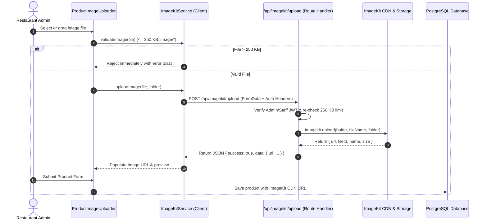

# ImageKit Integration Documentation

This document provides a comprehensive guide to the **ImageKit** image upload and CDN integration implemented for product management (Add / Edit Product) in Culinary Conductor / Qdine.

---

## 1. Overview & Architecture

Previously, the product creation and editing forms required administrators to manually paste external image URLs. With this integration:
- Administrators can directly **drag & drop or upload image files** from their computer or mobile device.
- Uploaded images are securely stored in the **ImageKit Media Library** and delivered via global CDN.
- The resulting CDN URL is automatically assigned to `form.image_url` and saved to the database.
- A **strict 250 KB file size limit** is enforced on both client and server sides to preserve bandwidth and optimize page load performance.
- Direct URL input remains available as an optional fallback.



---

## 2. Environment Variables Configuration

Obtain your API keys from the **[ImageKit Developer Dashboard](https://imagekit.io/dashboard/developer/api-keys)**.

Add the following keys to `.env.local` (and your production deployment platform such as Vercel / Railway / Docker):

```env
# ImageKit Server Credentials
IMAGEKIT_PUBLIC_KEY=public_xxxxxxxxxxxxxxxxxxxxxxxx
IMAGEKIT_PRIVATE_KEY=private_xxxxxxxxxxxxxxxxxxxxxxx
IMAGEKIT_URL_ENDPOINT=https://ik.imagekit.io/your_imagekit_id/

# ImageKit Public Client Aliases (Optional, for client-side SDK compatibility)
NEXT_PUBLIC_IMAGEKIT_PUBLIC_KEY=public_xxxxxxxxxxxxxxxxxxxxxxxx
NEXT_PUBLIC_IMAGEKIT_URL_ENDPOINT=https://ik.imagekit.io/your_imagekit_id/
```

> **Security Note:** `IMAGEKIT_PRIVATE_KEY` is strictly used on the server side in Next.js Route Handlers and is never exposed to the client browser.

---

## 3. Upload Constraints & Validation

| Parameter | Specification | Enforced At |
| :--- | :--- | :--- |
| **Max File Size** | **250 KB** (256,000 bytes) | Client-side pre-flight + Server Route Handler |
| **Allowed File Types** | JPEG, PNG, WebP, GIF, SVG (`image/*`) | Client-side input filter + Server MIME verification |
| **Destination Folder** | `/products` or `/products/{restaurant_slug}` | Dynamically resolved from `x-restaurant-slug` header |
| **File Naming** | Sanitized alphanumeric characters with unique IDs | ImageKit `useUniqueFileName: true` |
| **Authentication** | Admin or Staff JWT Token | Route Handler (`requireAdmin`) |

---

## 4. File Structure & Component Roles

### 1. `src/lib/imagekit.ts`
Initializes the official ImageKit Node.js SDK (`imagekit` v6) and exports helper functions:
- `getImageKitClient()`: Instantiates the SDK using environment variables with validation.
- `uploadToImageKit(buffer, fileName, folder)`: Converts memory buffers and uploads to ImageKit.
- `getImageKitAuthParameters()`: Generates `token`, `expire`, and `signature` for direct client authentication.

### 2. `src/app/api/imagekit/upload/route.ts`
Next.js App Router Route Handler for handling multipart file uploads:
- Authenticates the caller using `requireAdmin(request)`.
- Validates that the file size does not exceed **250 KB**.
- Rejects non-image MIME types.
- Sends the image buffer to ImageKit and responds with `{ success: true, data: { url, fileId, ... } }`.

### 3. `src/app/api/imagekit/auth/route.ts`
Endpoint providing signed authentication parameters as documented in the [ImageKit Next.js Integration Guide](https://imagekit.io/docs/integration/nextjs).

### 4. `src/app/services/imagekit.service.ts`
Frontend service class containing:
- `validateImage(file)`: Client-side validation ensuring immediate feedback before network transmission.
- `uploadImage(file, folder)`: Sends `FormData` with auth tokens and restaurant slug to `/api/imagekit/upload`.
- `getOptimizedUrl(url, transformations)`: Helper to build ImageKit real-time transformation parameters (e.g., resizing, quality adjustment).

### 5. `src/components/modules/products/ProductImageUploader.tsx`
Clean interactive UI component featuring:
- Drag-and-drop dropzone with hover feedback.
- Prominent **"Max 250 KB"** badge and supported format indicators.
- Real-time upload spinner and progress feedback.
- Uploaded image preview card showing clean image thumbnail, upload confirmation badge, and "Replace" / "Remove" actions.
- Automatically handles the URL assignment internally without exposing clutter or raw URLs.

### 6. `src/components/AdminProductForm.tsx`
Integrated `ProductImageUploader` into the product creation and edit modal. When an image is uploaded, it seamlessly stores the ImageKit URL in `form.image_url` and persists upon form submission.

---

## 5. ImageKit Dynamic Transformations

Because all images are served through ImageKit's global CDN, you can dynamically optimize delivery across devices using URL query parameters:

| Transformation | Syntax Example | Result |
| :--- | :--- | :--- |
| **Thumbnail (100x100)** | `https://ik.imagekit.io/.../image.jpg?tr=w-100,h-100,fo-auto` | Resized and center-cropped square thumbnail |
| **Card Image (400px)** | `https://ik.imagekit.io/.../image.jpg?tr=w-400,q-80,f-auto` | Auto WebP/AVIF format with 80% quality |
| **Retina / Hi-DPI** | `https://ik.imagekit.io/.../image.jpg?tr=dpr-2` | 2x pixel density for high-resolution displays |

---

## 6. Testing & Verification

1. **Verify Environment Variables:**
   Ensure `.env.local` contains valid ImageKit credentials (`IMAGEKIT_PUBLIC_KEY`, `IMAGEKIT_PRIVATE_KEY`, `IMAGEKIT_URL_ENDPOINT`).

2. **Add / Edit Product UI:**
   - Navigate to `/[slug]/admin/products`.
   - Click **Add Product** or edit an existing product.
   - Observe the **Product Image** card with the **Max 250 KB** badge.

3. **Validate 250 KB Size Enforcement:**
   - Attempt to upload an image larger than 250 KB (e.g., a 1 MB photo).
   - An error toast appears: *"Image size (X KB) exceeds the maximum allowed limit of 250 KB. Please choose a smaller image or compress it."*
   - No request is dispatched to the server.

4. **Upload a Valid Image (< 250 KB):**
   - Drag or choose a valid image under 250 KB (e.g. 80 KB PNG/JPEG).
   - The upload animation runs, and a success toast appears.
   - The preview updates instantly with the ImageKit URL.
   - Click **Save Product**; verify that the product persists with the ImageKit URL in the database and displays on the POS and customer menus.
