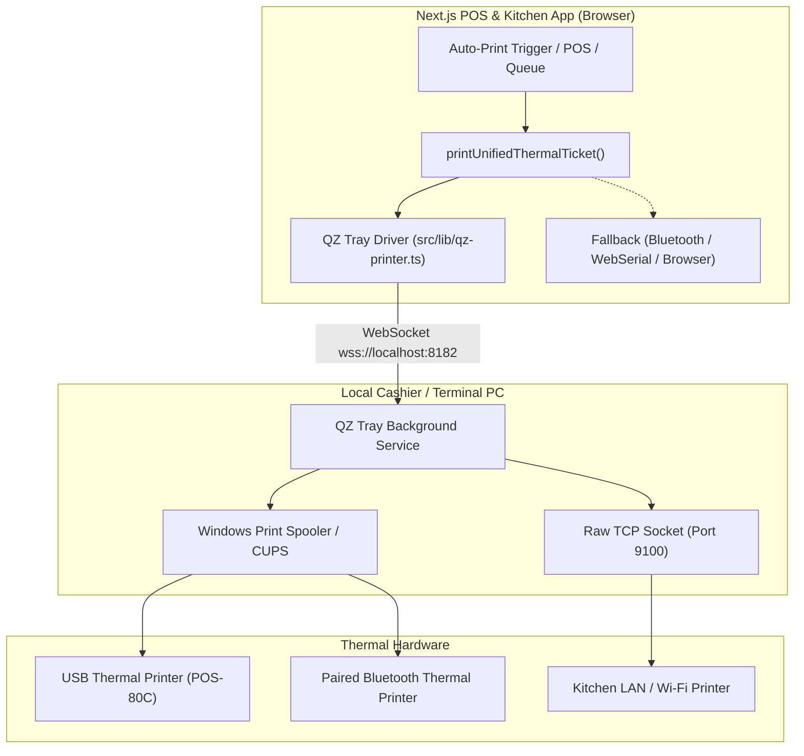

# QZ Tray Integration Architecture & Implementation Plan

## 1. Executive Summary

**QZ Tray** is a lightweight, cross-platform background application (Windows, macOS, Linux) that acts as a secure local WebSocket bridge between web browsers and physical hardware (Thermal Printers, ESC/POS, USB, Serial, Network/Ethernet).

### Why QZ Tray?
In the current web architecture:
1. **Windows Spooler Lockout**: When a thermal printer (e.g. POS-80C) is installed via USB driver, Windows locks the COM/USB port (`USB001`), causing Web Serial to fail with `NetworkError` or `Access Denied`.
2. **Browser Print Dialogs**: Standard browser `window.print()` requires staff intervention or Chrome Kiosk flags.
3. **Web Bluetooth Limitations**: Requires manual browser pairing prompts and is unstable in background tabs or on multi-terminal setups.
4. **Local Hardware Access**: QZ Tray runs natively on `localhost:8182` (WSS) / `localhost:8181` (WS), enabling **instant, silent, raw ESC/POS ticket printing** to any installed OS printer or network IP.

---

## 2. Architecture & Data Flow



---

## 3. Key Components to Build

### A. QZ Tray Client Service (`src/lib/qz-printer.ts`)
A singleton manager that handles:
1. **WebSocket Connection Lifecycle**:
   - Auto-connects to `wss://localhost:8182` with fallback to `ws://localhost:8181`.
   - Heartbeat & auto-reconnect if QZ Tray is restarted.
2. **Printer Discovery**:
   - `qz.printers.find()` to dynamically detect all installed Windows/Mac printers.
   - Allows users to pick from a dropdown of real printers instead of typing names manually.
3. **Raw ESC/POS Dispatch**:
   - Accepts `base64Bytes` generated by our existing `buildKotEscposBuffer`.
   - Sends raw commands with auto-cutter support without opening any print dialogs.

### B. Security & Digital Certificate (`/api/print/qz-sign` - Optional / Recommended)
- QZ Tray Community edition shows a one-time dialog asking *"Allow site to print?"* and can be remembered permanently.
- For 100% silent deployment without any prompt, an API route can sign print requests using a private RSA key + digital certificate.

### C. Unified Print Pipeline Integration (`src/lib/hardware-printer.ts`)
Update `printUnifiedThermalTicket`:
```typescript
export async function printUnifiedThermalTicket(options: UnifiedPrintOptions) {
  // 1. Try QZ Tray first (fastest, most reliable, silent ESC/POS)
  if (isQzConnected()) {
    const qzRes = await printViaQzTray(options.printerName, options.base64Bytes);
    if (qzRes.success) return { success: true, method: 'qz-tray' };
  }

  // 2. Try Direct Bluetooth (if paired in browser)
  // 3. Try Direct Web Serial (if connected)
  // 4. Try Android RawBT Intent
  // 5. Fallback to Browser Driver Dialog
}
```

### D. Settings UI Integration (`src/components/CounterHardwareSettings.tsx`)
In the **Auto-Print & Hardware** tab:
1. **QZ Tray Bridge Status Indicator**:
   - `🟢 QZ Tray Connected` (v2.2.x) with active local port.
   - If offline: `⚪ QZ Tray Offline` + download link `Download QZ Tray (Free)`.
2. **Auto-Populated Printer Dropdown**:
   - Instead of typing `POS-80C` manually, a **"Detect Printers"** button populates the dropdown with all actual printers installed on the PC.
3. **Test Print Verification**:
   - 1-click test ticket sent via QZ Tray directly to verify paper cut and formatting.

---

## 4. Implementation Steps

| Step | Action | Description |
| :--- | :--- | :--- |
| **Phase 1** | **Install Dependency** | Add `qz-tray` npm package or client script loader. |
| **Phase 2** | **Create QZ Controller** | Implement `src/lib/qz-printer.ts` with connect, disconnect, printer listing, and raw printing. |
| **Phase 3** | **Hook into Hardware Pipeline** | Modify `src/lib/hardware-printer.ts` to prioritize QZ Tray before falling back. |
| **Phase 4** | **Update Settings UI** | Enhance `CounterHardwareSettings.tsx` with QZ Tray connection state and printer auto-detection. |
| **Phase 5** | **Test End-to-End** | Test with thermal printer on USB, Network IP, and verify silent printing on Windows. |

---

## 5. Fallback & Graceful Degradation Strategy

If a staff member opens the POS on a device where QZ Tray is **not** installed (e.g. an iPad or Android tablet):
- The app automatically detects that QZ Tray WebSocket is not reachable.
- It seamlessly falls back to:
  1. Direct Web Bluetooth (for mobile Bluetooth thermal printers).
  2. RawBT thermal print intent (on Android devices).
  3. Clean thermal HTML preview / browser print dialog.
- **Zero breakage or blocking**: Existing functionality remains 100% operational.
